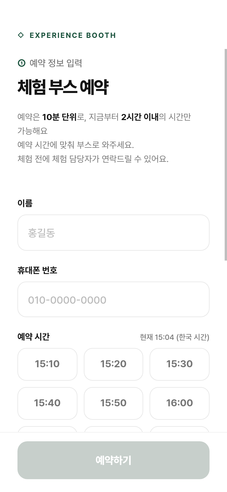
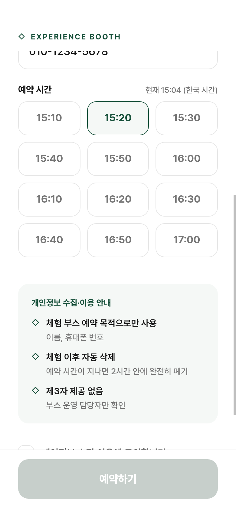
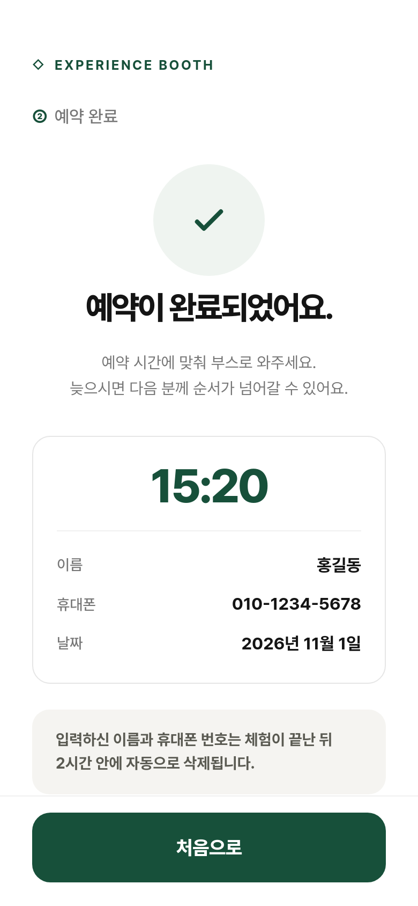
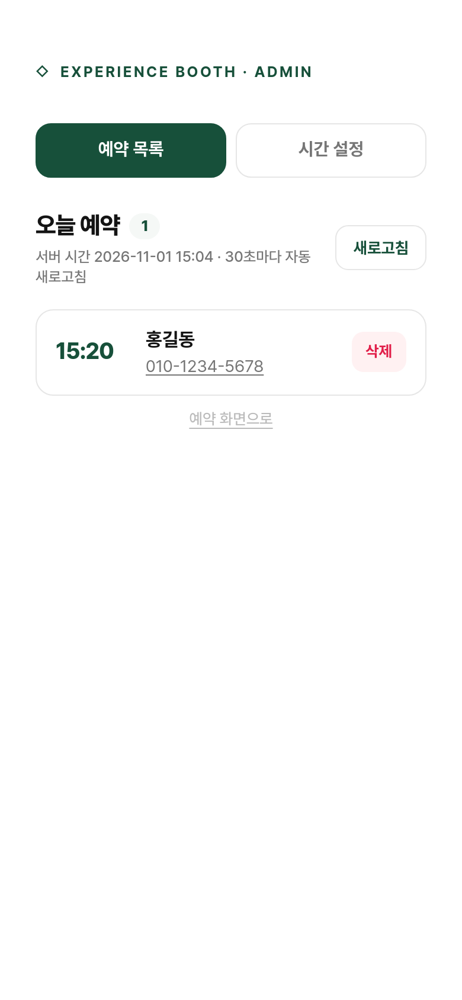
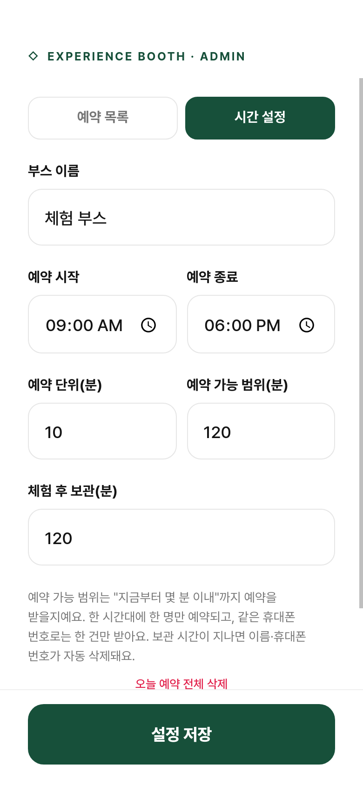

# 체험 부스 예약 (miso-reservation)

행사장 체험 부스용 한 페이지 예약 사이트입니다. 방문객이 이름과 휴대폰 번호를 남기고
10분 단위 시간을 골라 예약하고, 담당자는 관리자 화면에서 운영 시간을 조정하고 예약자를 확인합니다.
기존 체험 사이트(healthzone.misoinfo.co.kr)의 글씨체(Pretendard), 색상, 여백, 버튼 스타일을 그대로 가져왔습니다.

## 화면

휴대폰(390×844) 기준 화면입니다.

| 예약 입력 | 시간 선택 | 예약 완료 | 관리자 목록 | 시간 설정 |
|---|---|---|---|---|
|  |  |  |  |  |

## 매뉴얼

- [사용자 매뉴얼](docs/user-manual.md) — 방문객이 예약하는 순서
- [관리자 매뉴얼](docs/admin-manual.md) — 운영 시간 조정, 예약자 확인·삭제 ([PDF](docs/admin-manual.pdf), A4 10쪽)

PDF 는 `docs/admin-manual.html` 을 Chromium 으로 인쇄한 것입니다. 내용을 고친 뒤 다시 만들려면:

```bash
cd docs && chromium --headless=new --no-pdf-header-footer --print-to-pdf=admin-manual.pdf "file://$PWD/admin-manual.html"
```

## 주요 기능

### 방문객 화면
- 이름, 휴대폰 번호 입력 (번호는 자동으로 하이픈 처리)
- **10분 단위** 시간 선택, **한국 시간 기준 지금부터 2시간 이내**만 예약 가능
- 예약 가능 시간은 기본 **09:00 ~ 18:00** (18:00 전에 시작하는 슬롯까지)
- 이미 예약된 시간은 **마감** 처리되어 선택할 수 없음 (한 시간대 한 명)
- 같은 휴대폰 번호로는 한 건만 예약 가능
- 개인정보 수집·이용 안내와 동의 체크 (수집 목적: 체험 부스 예약)
- 예약 완료 화면에서 시간·이름·번호 확인
- 시간 목록은 30초마다 자동 갱신

### 관리자 화면 (`#admin`)
- 비밀번호 로그인 (환경변수 `ADMIN_KEY`, 기본값 `miso1234`)
- **시간 설정**: 예약 시작/종료 시각, 예약 단위(분), 예약 가능 범위(분), 체험 후 보관 시간(분), 부스 이름
- **예약 목록**: 시간순 정렬, 전화 걸기 링크, 개별 삭제, 전체 삭제, 30초 자동 새로고침

### 개인정보 자동 삭제
- 예약 시간이 지나고 보관 시간(기본 **120분**)이 지나면 이름과 휴대폰 번호가 서버에서 자동 삭제됩니다.
- 삭제 주기는 관리자 화면에서 조정할 수 있습니다.

## 실행

Node.js 18 이상만 있으면 됩니다. 외부 패키지 의존성이 없습니다.

```bash
git clone git@github.com:WooyeongJang/miso-reservation.git
cd miso-reservation

# 기본 실행 (127.0.0.1:5500)
./start.sh

# 포트와 관리자 비밀번호 지정
PORT=5501 ADMIN_KEY=비밀번호 ./start.sh

# 중지
kill $(cat logs/server.pid)
```

또는 직접 실행:

```bash
PORT=5500 ADMIN_KEY=비밀번호 node server.js
```

- 로그: `logs/server.log`
- 데이터: `data/db.json` (설정 + 예약 목록, git에는 올라가지 않음)

## 접속 주소

- 예약 화면: `http://127.0.0.1:5500/`
- 관리자 화면: `http://127.0.0.1:5500/#admin`
- 개발 서버 포탈: https://dev.daonlabs.kr/r/5500/

서버는 `127.0.0.1`에만 바인딩하고 외부 노출은 nginx 같은 리버스 프록시가 맡습니다.
경로 앞의 `/r/<포트>` 접두사는 서버가 떼어내고 처리하며, 페이지의 링크와 API 호출은 모두 상대 경로라서
어떤 base path 아래에 두어도 동작합니다.

## API

| 메서드 | 경로 | 설명 |
|---|---|---|
| GET | `/api/slots` | 현재 예약 가능한 시간 목록, 서버 시간(KST), 설정 |
| POST | `/api/reserve` | 예약 생성 `{ name, phone, time, consent }` |
| GET | `/api/admin/login` | 관리자 비밀번호 확인 |
| GET | `/api/admin/settings` | 설정 조회 |
| PUT | `/api/admin/settings` | 설정 변경 |
| GET | `/api/admin/reservations` | 예약 목록 |
| DELETE | `/api/admin/reservations/:id` | 예약 한 건 삭제 |
| DELETE | `/api/admin/reservations` | 예약 전체 삭제 |

관리자 API는 `X-Admin-Key` 헤더로 인증합니다.

```bash
curl -X PUT http://127.0.0.1:5500/api/admin/settings \
  -H 'X-Admin-Key: miso1234' -H 'Content-Type: application/json' \
  -d '{"openTime":"10:00","closeTime":"17:00","windowMinutes":120}'
```

## 설정 항목

| 항목 | 기본값 | 설명 |
|---|---|---|
| `openTime` | `09:00` | 예약 시작 시각 |
| `closeTime` | `18:00` | 예약 종료 시각 (이 시각 전에 시작하는 슬롯까지) |
| `slotMinutes` | `10` | 예약 단위(분) |
| `windowMinutes` | `120` | 지금부터 몇 분 이내까지 예약을 받을지 |
| `retainMinutes` | `120` | 체험 시각이 지나고 몇 분 뒤 자동 삭제할지 |
| `boothName` | `체험 부스` | 화면 제목에 쓰이는 부스 이름 |

## 데이터 관리

- 별도 DB 없이 `data/db.json` 파일 하나에 저장합니다. 변경이 생길 때마다 임시 파일에 쓴 뒤 교체하므로 서버를 재시작해도 유지됩니다.
- 요청이 들어올 때마다 보관 시간이 지난 예약을 지웁니다.
- 백업은 `data/db.json` 복사로 충분합니다. 서버 여러 대로 늘리거나 장기 통계가 필요하면 SQLite나 PostgreSQL로 옮기는 것을 권합니다.

## 프로젝트 구조

```
server.js          # HTTP 서버 + API, KST 시간 계산, 자동 삭제
public/index.html  # 예약 / 완료 / 관리자 화면 (한 페이지)
public/style.css   # healthzone 스타일 이식 (Pretendard, 색상 변수, 여백)
public/app.js      # 화면 전환, 폼 검증, 슬롯 갱신, 관리자 로직
start.sh           # 백그라운드 실행 스크립트
```

## 시간 기준

모든 시간 계산은 한국 표준시(KST, UTC+9) 기준입니다. 서버의 시간대 설정과 무관하게 동작하며,
클라이언트 기기의 시간은 사용하지 않습니다.
