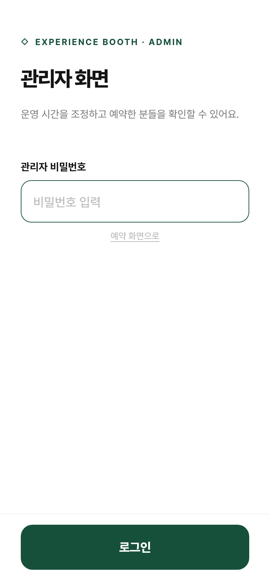
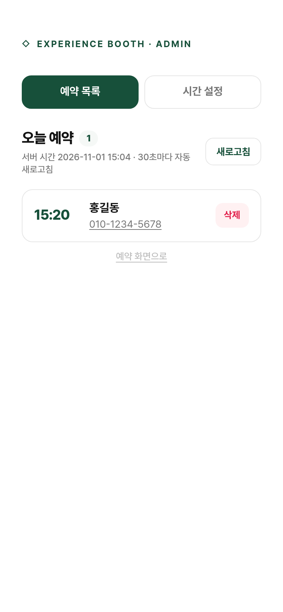
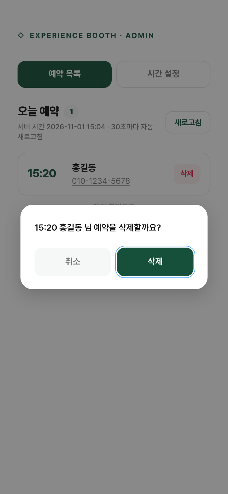
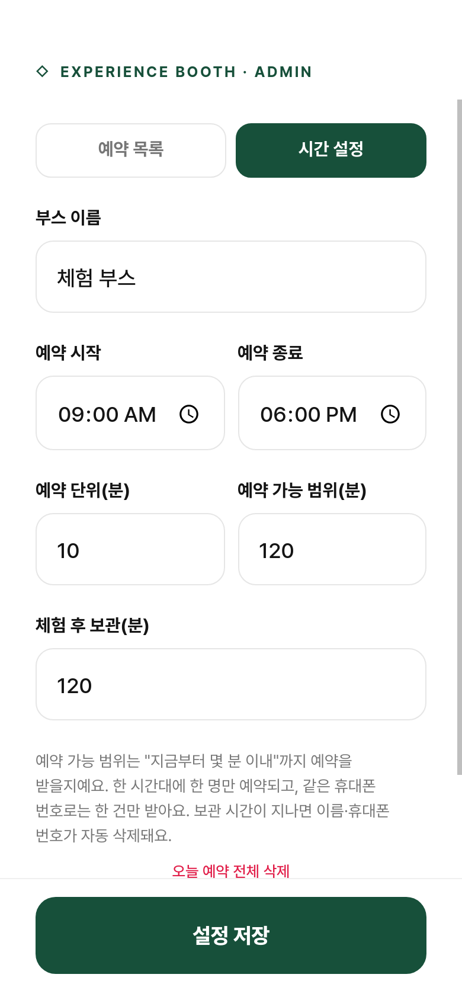
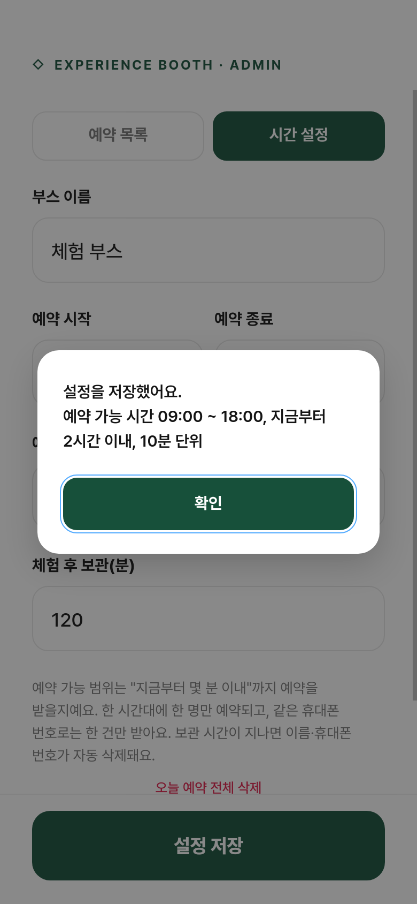

# 관리자 매뉴얼 — 체험 부스 예약

부스 운영 담당자가 운영 시간을 조정하고 예약자를 확인하는 방법입니다. 화면은 휴대폰(390×844) 기준으로 캡처했습니다.

## 1. 관리자 화면 열기

예약 화면 주소 뒤에 `#admin` 을 붙여 접속하거나, 예약 화면 맨 아래의 작은 **관리자** 링크를 누릅니다.

- 예: `https://dev.daonlabs.kr/r/5501/#admin`

관리자 비밀번호를 입력하고 **로그인** 을 누릅니다. 비밀번호는 서버 실행 시 `ADMIN_KEY` 환경변수로 정하며, 기본값은 `miso1234` 입니다. 행사 전에 꼭 바꿔 주세요.



로그인 상태는 브라우저 탭을 닫을 때까지 유지됩니다. 비밀번호가 바뀌면 다시 로그인해야 합니다.

## 2. 예약 목록

로그인하면 **예약 목록** 탭이 먼저 열립니다.

- 오늘 예약이 **시간순**으로 표시되고, 상단에 건수가 보입니다.
- 서버 시간(한국 시간)이 함께 표시되며 30초마다 자동으로 새로 고쳐집니다. **새로고침** 버튼으로 바로 갱신할 수도 있습니다.
- 휴대폰 번호를 누르면 바로 전화를 걸 수 있습니다. 체험 전 연락할 때 사용하세요.
- 예약 시간이 지난 건은 흐리게 표시되고 이름 뒤에 "(지남)"이 붙습니다.



### 예약 삭제

노쇼(오지 않음)나 취소 요청이 있으면 해당 건의 **삭제** 를 누르고 확인 창에서 **삭제** 를 누릅니다. 삭제하면 그 시간은 다시 예약 가능한 상태로 돌아가고, 그 번호로 다시 예약할 수 있게 됩니다.



## 2-1. 예약 확인 문자

예약이 완료되면 손님의 휴대폰으로 확인 문자(LMS)가 자동 발송됩니다. 예약 목록의 번호 옆에 상태가 표시됩니다.

| 표시 | 뜻 |
|---|---|
| 문자 전송 | 정상 발송됨 |
| 문자 실패 | 발송 실패. 표시를 길게 누르면 이유가 보임 |
| 문자 없음 | 문자 기능이 꺼져 있음 (목록 상단에 이유 표시) |

실패한 건은 **문자 재전송** 버튼으로 다시 보낼 수 있습니다. 문자 발송이 실패해도 예약 자체는 유지됩니다.

문자 설정(비즈고 API Key, 발신번호)은 서버의 `.env` 파일에 있으며, 비어 있으면 문자 없이 예약만 받습니다.

## 3. 시간 설정

**시간 설정** 탭에서 운영 조건을 바꿀 수 있습니다. 값을 고친 뒤 아래 **설정 저장** 을 누르면 바로 적용됩니다.

| 항목 | 기본값 | 설명 |
|---|---|---|
| 부스 이름 | 체험 부스 | 예약 화면 제목에 "OO 예약"으로 표시 |
| 예약 시작 | 09:00 | 이 시각부터 예약 슬롯이 생김 |
| 예약 종료 | 18:00 | 이 시각 **전에 시작하는** 슬롯까지 (18:00이면 마지막 슬롯은 17:50) |
| 예약 단위(분) | 10 | 슬롯 간격. 5~120분 |
| 예약 가능 범위(분) | 120 | "지금부터 몇 분 이내"까지 예약을 받을지. 10~720분 |
| 체험 후 보관(분) | 120 | 예약 시간이 지나고 몇 분 뒤 이름·번호를 자동 삭제할지. 0~1440분 |



저장이 끝나면 적용된 운영 시간이 안내됩니다.



### 자주 쓰는 조정 예

- **점심시간에 잠시 예약을 막고 싶을 때**: 예약 가능 범위를 10분으로 줄였다가, 다시 받을 때 120분으로 되돌립니다.
- **마감 시간을 앞당길 때**: 예약 종료를 17:00으로 바꿉니다. 이미 잡힌 17:00 이후 예약은 목록에 남으니 필요하면 삭제하고 연락합니다.
- **대기가 길어져 간격을 넓힐 때**: 예약 단위를 15분이나 20분으로 바꿉니다. 이미 잡힌 예약은 그대로 유지됩니다.

## 4. 전체 삭제

**시간 설정** 탭 맨 아래의 **오늘 예약 전체 삭제** 는 모든 예약을 한 번에 지웁니다. 되돌릴 수 없으니 행사 종료 후 정리할 때만 사용하세요.

## 5. 개인정보 자동 삭제

예약 시간이 지나고 "체험 후 보관(분)"이 지나면 서버가 이름과 휴대폰 번호를 자동으로 지웁니다. 별도 조작은 필요 없습니다. 행사 종료 후 바로 전부 지우고 싶으면 **오늘 예약 전체 삭제** 를 사용하세요.

## 6. 서버 운영 참고

```bash
# 실행 (비밀번호 지정)
ADMIN_KEY=새비밀번호 ./start.sh

# 중지
kill $(cat logs/server.pid)

# 로그 확인
tail -f logs/server.log
```

- 데이터는 `data/db.json` 한 파일에 저장됩니다. 백업은 이 파일만 복사하면 됩니다.
- 서버를 재시작해도 설정과 예약은 유지됩니다.
- 문제가 생기면 서버를 멈추고 `data/db.json` 을 지운 뒤 다시 실행하면 기본 설정으로 초기화됩니다.
