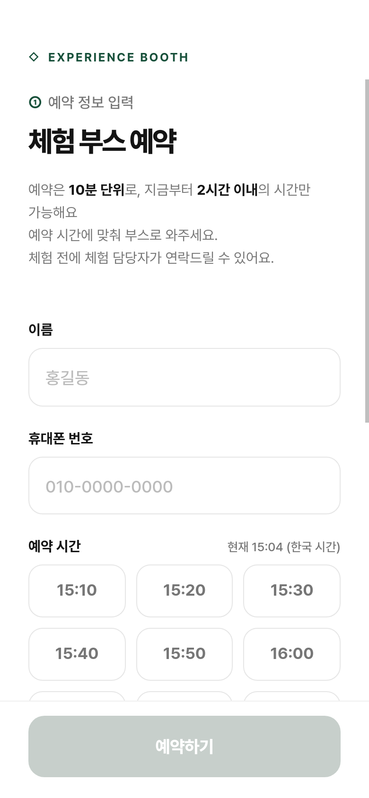
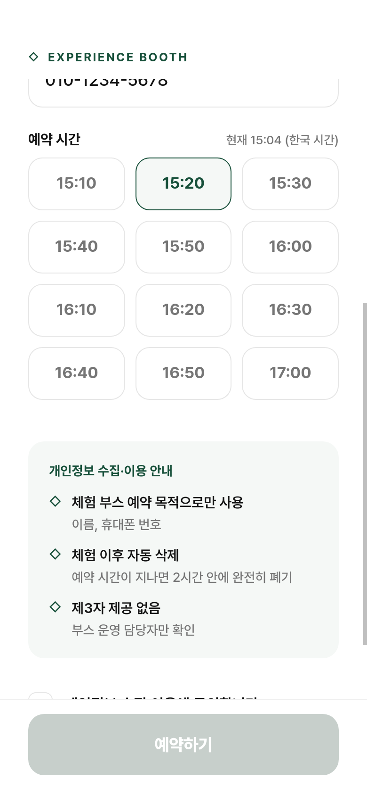
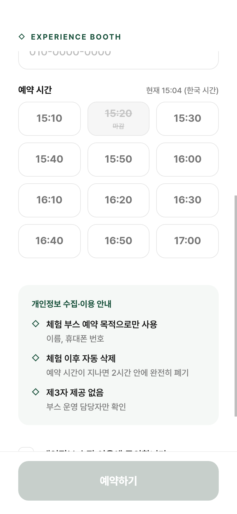
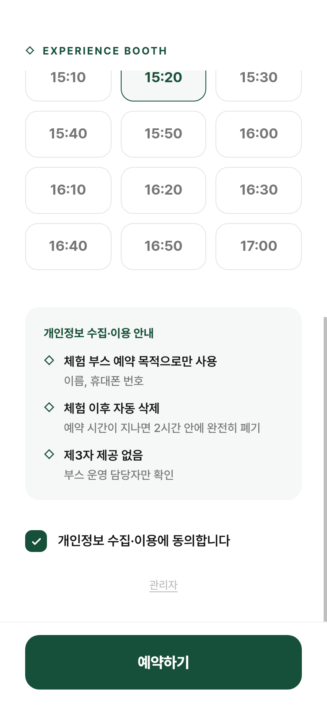
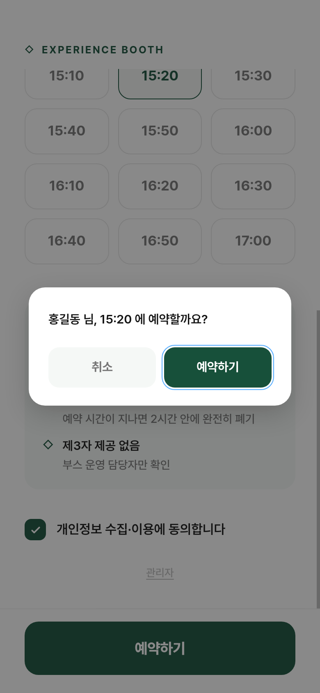
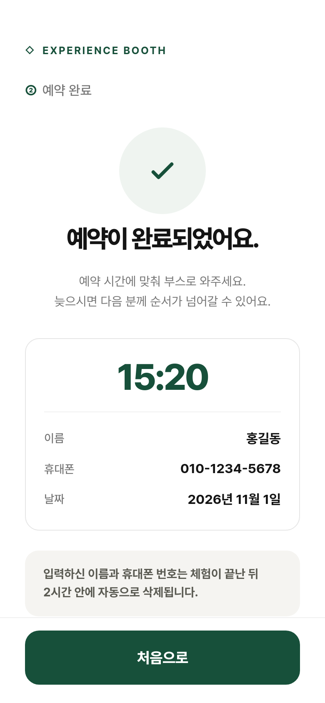
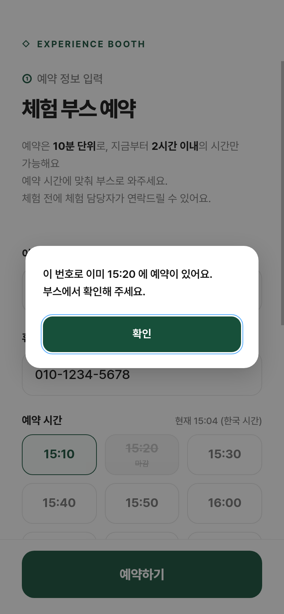

# 사용자 매뉴얼 — 체험 부스 예약

방문객이 휴대폰으로 체험 부스를 예약하는 방법입니다. 화면은 휴대폰(390×844) 기준으로 캡처했습니다.

## 1. 예약 화면 열기

행사장에 안내된 QR 코드나 주소로 접속하면 바로 예약 화면이 열립니다.

- 예약은 **10분 단위**이고, **지금부터 2시간 이내**의 시간만 고를 수 있습니다.
- 예약 가능 시간은 **09:00 ~ 18:00** 입니다. 운영 상황에 따라 담당자가 조정할 수 있습니다.
- 화면 오른쪽의 "현재 시각"은 한국 시간 기준 서버 시간입니다.

## 2. 이름과 휴대폰 번호 입력

- **이름**: 1~20자
- **휴대폰 번호**: 숫자만 입력하면 하이픈(-)이 자동으로 붙습니다. 010으로 시작하는 10~11자리 번호만 받습니다.

## 3. 예약 시간 선택

원하는 시간을 한 개 누릅니다. 선택한 시간은 초록색 테두리로 표시됩니다.

이미 다른 분이 예약한 시간은 **마감**으로 표시되고 누를 수 없습니다. 시간 목록은 30초마다 자동으로 갱신됩니다.

## 4. 개인정보 수집·이용 동의

안내 카드를 읽고 **"개인정보 수집·이용에 동의합니다"** 를 체크합니다. 이름, 번호, 시간이 모두 채워지고 동의까지 하면 아래 **예약하기** 버튼이 초록색으로 바뀝니다.

- 수집 목적: 체험 부스 예약
- 수집 항목: 이름, 휴대폰 번호
- 보관 기간: 예약 시간이 지나면 2시간 안에 자동 삭제
- 제3자 제공 없음

## 5. 예약하기

**예약하기** 를 누르면 확인 창이 뜹니다. 이름과 시간을 확인하고 **예약하기** 를 한 번 더 누릅니다.

## 6. 예약 완료

예약 시간, 이름, 휴대폰 번호, 날짜가 표시됩니다. 이 화면을 캡처해 두면 부스에서 확인할 때 편합니다.

- 예약 시간에 맞춰 부스로 와주세요. 늦으면 다음 분께 순서가 넘어갈 수 있습니다.
- 체험 전에 담당자가 연락할 수 있습니다.
- **처음으로** 를 누르면 다른 사람이 예약할 수 있도록 입력 화면으로 돌아갑니다.

## 자주 묻는 질문

**같은 번호로 두 번 예약할 수 있나요?**
아니요. 한 번호로는 한 건만 예약됩니다. 다시 예약하려 하면 기존 예약 시간을 알려주는 안내가 뜹니다. 시간을 바꾸려면 부스 담당자에게 말씀해 주세요.

**방금 고른 시간이 "마감"이라고 나와요.**
거의 같은 순간에 다른 분이 먼저 예약한 경우입니다. 시간 목록이 새로 고쳐지니 다른 시간을 골라 주세요.

**시간 목록이 비어 있어요.**
오늘 예약 시간이 끝났거나(18:00 이후), 아직 예약을 받기 전(09:00보다 2시간 이상 이전)이면 안내 문구가 표시됩니다.

**내 정보는 언제 지워지나요?**
예약 시간이 지나고 2시간 뒤에 서버에서 자동으로 삭제됩니다. 부스 담당자가 그 전에 직접 삭제할 수도 있습니다.
